<!-- github.com/rakibulx33 · same terminal theme as https://rakibulx33.me -->

<a href="https://rakibulx33.me"></a>

<p align="center">
  <a href="https://rakibulx33.me"></a>
  <a href="https://www.linkedin.com/in/rakibulx33"></a>
  <a href="mailto:rakibulx33@gmail.com"></a>
</p>

I'm a freelance **backend and automation developer** in Dhaka, Bangladesh, and a CSE student at Daffodil International University. Since 2022 I've been building the systems behind online stores, AI-powered SaaS and trading bots, and researching low-cost IoT on the side.

My portfolio, **[rakibulx33.me](https://rakibulx33.me)**, is a working terminal. Open it and type `whoami`.

<br>

<picture>
  <source media="(prefers-color-scheme: dark)" srcset="https://raw.githubusercontent.com/rakibulx33/rakibulx33/main/assets/h-services-dark.svg">
  
</picture>

- **Backend systems and APIs.** REST and real-time APIs, databases and background jobs in Node.js, Laravel and FastAPI, built to run reliably in production.
- **E-commerce for Bangladesh.** Online stores and admin panels with the payment and delivery options Bangladeshi customers expect.
- **Automation and AI integrations.** Chatbots, n8n workflows and LLM features that answer customers, sync data between tools and remove manual work.
- **IoT prototypes.** ESP32-based sensing and monitoring systems, from the device and firmware to the dashboard.

<br>

<picture>
  <source media="(prefers-color-scheme: dark)" srcset="https://raw.githubusercontent.com/rakibulx33/rakibulx33/main/assets/h-projects-dark.svg">
  
</picture>

| Project | What it is | Built with | Links |
| :-- | :-- | :-- | :-- |
| **BuildIoT BD** | A full online store for electronics and IoT parts in Bangladesh, with customer accounts, local payments and delivery, and a staff admin panel. | Laravel, Tailwind CSS | `private` |
| **TradingSpark** | Breeds thousands of trading-strategy variants with a genetic algorithm, forward-tests the survivors on unseen data and runs the winners 24/7, demo first. | Python, NautilusTrader, React | [source](https://github.com/rakibulx33/tradingspark) |
| **ShopTalk** | Multi-tenant storefronts where each shop gets an AI assistant that helps customers find products by voice and chat. | Next.js, Supabase, AI | `private` |
| **Replixon** | An AI-assisted inbox that brings a business's social messaging channels into one place and helps answer customers faster. | Next.js, Supabase, AI | `private` |
| **InstaMiner** | A social engagement platform with a native Android app, a backend API and an admin panel. | Kotlin, Python, Next.js | `private` |
| **Tender Package Builder** | Turns a tender's requirements and a set of PDFs into one checked, correctly ordered PDF package, fully in the browser, in English and Bangla. Solo build for AI DevFest 2026. | React, Vite, pdf-lib | [live](https://rakibulx33.github.io/devfest-241-15-223/), [source](https://github.com/rakibulx33/devfest-241-15-223) |

Private repositories are described without code; I'm happy to walk through them on a call.

<details>
<summary><b>Also built</b>: 11 more projects</summary>

<br>

| Project | What it does | Built with | Links |
| :-- | :-- | :-- | :-- |
| **Smart Escape** | Evacuation route simulator that recalculates the safest exit as corridors are blocked. English and Bangla. | JavaScript, SVG | [live](https://rakibulx33.github.io/AI-DEV-FEST-2026-VIBE-CODING-MOCK/), [source](https://github.com/rakibulx33/AI-DEV-FEST-2026-VIBE-CODING-MOCK) |
| **Mosque Admin Panel** | Members, donations, expenses, bank ledger and printable Bengali reports, with role-based access. | Express, PostgreSQL, Knex | [source](https://github.com/rakibulx33/Baitur-Rahman-Jame-Mosjid) |
| **DIU Job Hub** | University job platform with student, recruiter and admin portals and AI job matching. | Next.js, TypeScript, MySQL | [source](https://github.com/rakibulx33/diujobhub) |
| **Upbit Watch** | Watches four crypto exchanges for new listings and sends live Telegram alerts. | Python, FastAPI, WebSocket | [source](https://github.com/rakibulx33/firstlight) |
| **MealNChill** | Meals, attendance, inventory and shared finances for hostels and shared homes. | Next.js, TypeScript, MongoDB | [source](https://github.com/rakibulx33/MealNChill) |
| **WaitWise** | Queue management: a JavaFX admin app plus a mobile view where customers join by QR code. | Java, JavaFX, MySQL | [source](https://github.com/rakibulx33/WaitWise) |
| **BongoScript** | A programming language with Bangla keywords, transpiled to C. Team compiler project. | Flex, Bison, C | [source](https://github.com/toha129/bongoscript_project) |
| **Winternet Meter** | Floating, always-on-top Windows meter for live upload and download speed. | C#, .NET | [source](https://github.com/rakibulx33/WinternetMeter) |
| **Cheatsheet Generator** | Drag-and-drop, block-based cheatsheet builder with PDF export. | React, dnd-kit, jsPDF | [source](https://github.com/rakibulx33/cheatSheetGenerator) |
| **NS Order Forward** | Android automation app for processing orders in the background. | Kotlin, Android | `private` |
| **ClanWar Coach** | Clan and player stats for Clash of Clans through a caching API proxy. | React, Express, Recharts | [source](https://github.com/rakibulx33/Clash-of-Clan-Status) |

</details>

<br>

<picture>
  <source media="(prefers-color-scheme: dark)" srcset="https://raw.githubusercontent.com/rakibulx33/rakibulx33/main/assets/h-research-dark.svg">
  
</picture>

Low-cost IoT for everyday problems in Bangladesh, written with classmates and faculty at Daffodil International University. All four are in preparation.

- **Smart energy monitoring for Bangladeshi homes.** Undergraduate thesis, DIU CSE. Low-cost IoT and machine learning to help households understand their electricity use and costs.
- **IoT monitoring for potato storage.** IEEE conference paper, second author. Low-cost sensing to reduce post-harvest losses in stored potatoes.
- **IoT monitoring for onion storage.** Conference paper. Low-cost sensing to reduce post-harvest losses in stored onions.
- **Device-free human presence sensing.** IEEE conference paper. Detecting whether people are in a room without cameras or wearables.

<br>

<picture>
  <source media="(prefers-color-scheme: dark)" srcset="https://raw.githubusercontent.com/rakibulx33/rakibulx33/main/assets/h-skills-dark.svg">
  
</picture>

```json
{
  "Languages": ["TypeScript", "JavaScript", "Python", "PHP", "Kotlin", "Java", "C#", "C", "C++"],
  "Backend": ["Node.js", "Express", "FastAPI", "Laravel", "Next.js", "REST", "WebSockets"],
  "Frontend & Mobile": ["React", "Tailwind CSS", "Livewire", "Filament",
                        "React Three Fiber", "Jetpack Compose"],
  "Data": ["PostgreSQL", "MySQL / MariaDB", "MongoDB", "Supabase", "Redis", "SQLite"],
  "AI & Automation": ["Groq", "Gemini", "Ollama", "n8n", "Selenium", "LLM evals"],
  "DevOps & IoT": ["Docker", "Linux", "GitHub Actions", "Cloudflare Tunnel", "ESP32", "LoRa"]
}
```

<br>

<picture>
  <source media="(prefers-color-scheme: dark)" srcset="https://raw.githubusercontent.com/rakibulx33/rakibulx33/main/assets/h-github-dark.svg">
  
</picture>

<picture>
  <source media="(prefers-color-scheme: dark)" srcset="https://raw.githubusercontent.com/rakibulx33/rakibulx33/output/github-snake-dark.svg">
  
</picture>

<br>

<picture>
  <source media="(prefers-color-scheme: dark)" srcset="https://raw.githubusercontent.com/rakibulx33/rakibulx33/main/assets/h-contact-dark.svg">
  
</picture>

```console
$ ping rakibul
PING rakibul (rakibulx33.me): 56 data bytes
64 bytes from rakibul: icmp_seq=0 status=available
64 bytes from rakibul: icmp_seq=1 open_to=freelance
64 bytes from rakibul: icmp_seq=2 location=Dhaka
--- 3 packets transmitted, 3 received, 0% packet loss ---
```

I take on freelance backend, automation and e-commerce work. Email is the fastest way to reach me: **[rakibulx33@gmail.com](mailto:rakibulx33@gmail.com)**. You can also find me on [LinkedIn](https://www.linkedin.com/in/rakibulx33) or at **[rakibulx33.me](https://rakibulx33.me)**.

<br>

<a href="https://rakibulx33.me"></a>
